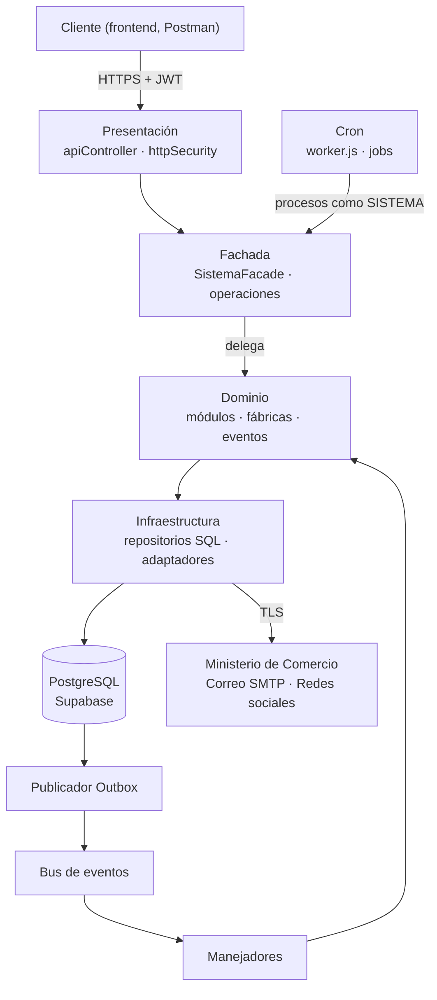
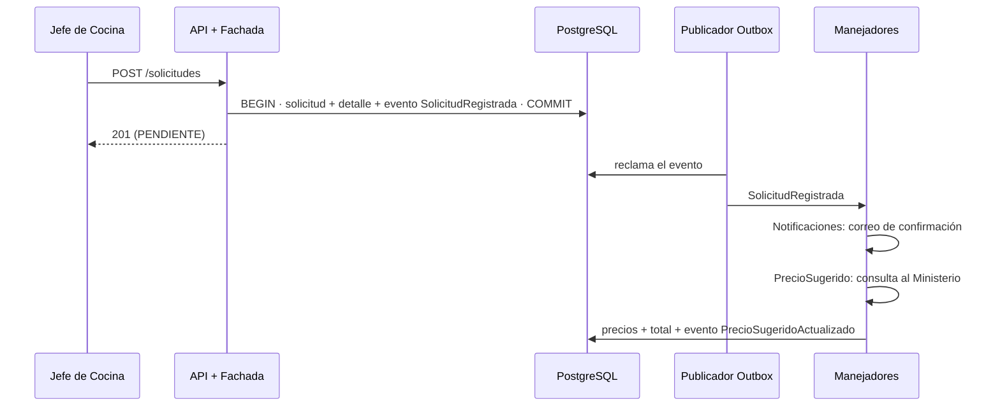

# Arquitectura

## Visión general

Dos procesos comparten el mismo código y la misma base de datos: la **API** (que además publica eventos) y el **cron** (procesos programados, que también publica eventos). Ambos se arman en un único lugar, `src/container.js`.

## Capas y responsabilidades

| Capa | Carpeta | Responsabilidad |
|---|---|---|
| Presentación | `src/presentation/` | Recibe HTTP y lo delega **directo** a la fachada. Cabeceras de seguridad, CORS, exigencia de TLS, límite de intentos de inicio de sesión y traducción de errores a HTTP |
| Fachada | `src/facade/` | **Único punto de entrada** para HTTP y cron. Valida token y rol, delega al módulo y registra la auditoría. El catálogo `operaciones.js` define cada operación con sus roles |
| Dominio | `src/domain/` | Lógica de negocio por módulo, eventos, fábricas y contratos de servicios externos. No importa nada de infraestructura: recibe sus dependencias por inyección |
| Infraestructura | `src/infrastructure/` | Conexión a PostgreSQL, adaptadores de servicios externos, publicador Outbox y registro de errores |
| Composición | `src/container.js` | Conecta las capas: crea adaptadores, repositorios, servicios y manejadores |

La dependencia va hacia adentro: Presentación → Fachada → Dominio, y la Infraestructura se inyecta en el Dominio, que solo conoce sus **contratos**.

## Patrones de diseño

| Patrón | Dónde | Para qué |
|---|---|---|
| **Facade** | `facade/SistemaFacade.js` | Un solo punto de acceso: seguridad y auditoría en un lugar, y los controladores sin lógica |
| **Factory Method** | `domain/factories/` (`NotificacionFactory` y tres creadores) | Construir confirmaciones de solicitud, alarmas de stock y promociones sin que quien las pide conozca su formato |
| **Adapter** | `domain/services/` (contratos) e `infrastructure/adapters/` | Aislar el Ministerio de Comercio, el correo y las redes sociales detrás de interfaces propias |
| **Outbox** | `infrastructure/outbox/EventOutboxPublisher.js` | El cambio de negocio y su evento se guardan en la misma transacción; un publicador los entrega después |
| **Arquitectura basada en eventos** | `domain/events/` | Desacoplar efectos secundarios (correos, validaciones, alarmas) de la operación que los origina |

### Cómo funciona el Outbox

1. Un módulo cambia el estado de negocio y llama a `registrarEvento(tx, tipo, payload)` con **la misma transacción**: ambos se confirman o ninguno.
2. El publicador (en la API y en el cron) reclama eventos pendientes con `FOR UPDATE SKIP LOCKED` y una reserva temporal: dos publicadores no toman el mismo evento y, si uno cae, otro lo retoma al vencer la reserva.
3. Entrega cada evento a sus manejadores. Si alguno falla, el evento se reintenta con espera creciente (hasta 6 intentos por defecto) y solo se reejecutan los manejadores que no terminaron.
4. La tabla `evento_procesado` garantiza que cada manejador procese cada evento una sola vez (entrega "al menos una vez" con idempotencia).

### Ejemplo: registrar una solicitud

## Persistencia

PostgreSQL en Supabase, con SQL directo mediante `pg`. El esquema completo está en `src/infrastructure/database/schema.sql` (idempotente).

| Grupo | Tablas |
|---|---|
| Catálogos y reglas | `punto`, `mesa`, `categoria`, `marca`, `unidad_medida`, `producto`, `proveedor`, `parametro` |
| Seguridad | `usuario` |
| Cocina | `plato`, `plato_ingrediente`, `pedido`, `pedido_detalle` |
| Inventario | `inventario`, `movimiento_inventario`, `alarma` |
| Compras | `solicitud_alimentos`, `detalle_solicitud`, `cotizacion`, `cotizacion_detalle`, `orden_compra` |
| Analítica y avisos | `tendencia`, `promocion`, `notificacion` |
| Auditoría y eventos | `auditoria`, `log_error`, `outbox`, `evento_procesado` |

Garantías que da la base de datos: `auditoria` y `log_error` no admiten `UPDATE` ni `DELETE` (triggers); una sola alarma activa por producto y punto (índice único parcial); el inventario no puede quedar negativo; los consecutivos de solicitudes, cotizaciones y órdenes salen de secuencias. Todas las tablas tienen la seguridad a nivel de fila activada, sin políticas: la API se conecta con credenciales propias y la clave pública de Supabase no puede leerlas.

## Seguridad

| Medida | Dónde |
|---|---|
| TLS 1.3 hacia la base de datos, el correo y los servicios externos; HTTPS propio con TLS 1.3 o proxy TLS delante de la API | `env.js`, adaptadores, `app.js` |
| Contraseñas con bcrypt, con un tope de cálculos simultáneos (procesadores menos uno) | `PasswordHasher.js` |
| JWT firmado de vida corta, con renovación y duración máxima de sesión | `TokenService.js`, `AuthService.js` |
| Roles verificados en la fachada y otra vez en cada módulo | `operaciones.js`, módulos |
| Bloqueo de cuenta tras intentos fallidos y límite por IP en el inicio de sesión | `AuthService.js`, `httpSecurity.js` |
| Auditoría inmutable de acciones, accesos y denegaciones | `AuditoriaService`, triggers |
| Valores de cotizaciones y órdenes visibles solo para el área de compras | Roles, tablero y auditoría sin montos |
| Sin SQL construido con datos del usuario: parámetros y listas blancas | Repositorios, `CatalogosDefinicion.js` |
| Cuerpo máximo de 100 KB, CORS por lista, cabeceras con Helmet | `httpSecurity.js`, `app.js` |
| Contenedores sin root, sistema de archivos de solo lectura y sin capacidades | `Dockerfile.*`, `docker-compose.yml` |

## Decisiones de diseño

| Decisión | Motivo |
|---|---|
| SQL directo con `pg` y no `supabase-js` | El Outbox necesita transacciones de varias sentencias, que PostgREST no ofrece |
| JWT sin estado con renovación | Cumple la expiración por inactividad sin tabla de sesiones; a cambio, cerrar sesión no invalida el token en el servidor |
| Alarmas por consulta (sondeo) y no en tiempo real | Supabase Realtime exige un JWT propio de Supabase, que este sistema no usa |
| Entrega de eventos "al menos una vez" con idempotencia por manejador | Un fallo de correo o del Ministerio se reintenta sin duplicar efectos |
| Catálogos como lista blanca (`CatalogosDefinicion.js`) | Un solo servicio genérico sin construir SQL con nombres que vengan del cliente |
| Cron en un contenedor aparte, con bloqueo asesor de PostgreSQL | Que escalar la API no duplique procesos programados, y que dos cron no ejecuten lo mismo |
| La unidad de un producto no cambia | Inventario, ingredientes y solicitudes dependen de ella |
| Errores de conexión con la base de datos como 503 con `Retry-After` | Son fallos temporales: el cliente debe reintentar, no es un error del sistema |
| Comparar la cotización con el subtotal sugerido de lo que cubre | Cotizaciones parciales se juzgan bien; coincide con el total si cubre todo |

## Pruebas y CI

`npm test` ejecuta más de 130 pruebas con su propia base PostgreSQL temporal (nunca Supabase): casos de uso, seguridad de la API (incluido TLS 1.3 real), envío real por SMTP, cron y la sincronía de esta documentación con el código. El CI de GitHub las repite contra PostgreSQL 16 y construye las dos imágenes Docker en cada cambio.

## Limitaciones conocidas

- Cerrar sesión no invalida el token en el servidor; dura hasta su vencimiento.
- Cambiar o restablecer una contraseña no cierra las sesiones abiertas: sus tokens siguen vigentes hasta vencer.
- No hay recuperación de contraseña por correo: la restablece el Administrador.
- Las notificaciones no tienen estado de lectura (leída o no leída): eso requeriría una columna nueva en la base de datos.
- Las alarmas no se empujan: la aplicación debe consultarlas.
- Los adaptadores del Ministerio de Comercio y de redes sociales asumen un formato de respuesta (descrito en cada adaptador) que debe confirmarse con las APIs reales.
- Este repositorio es solo el backend: no incluye el frontend.
