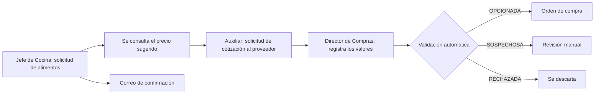
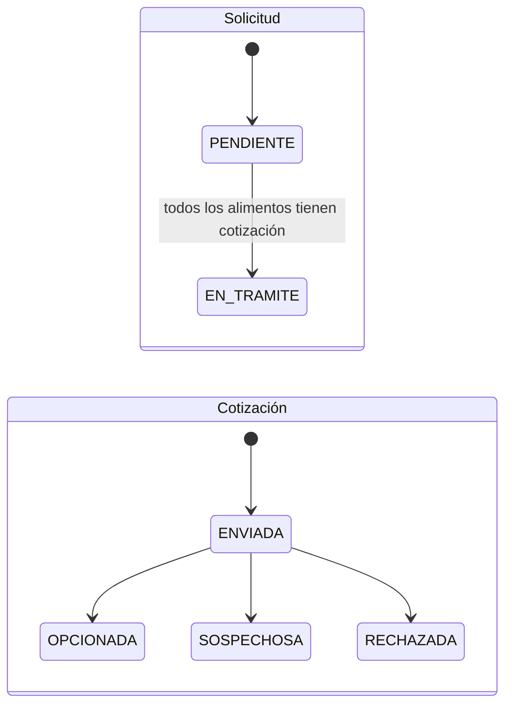

# Flujos de negocio

Cómo funciona cada proceso del sistema, de principio a fin. Las rutas están en la [Referencia de la API](API.md); los valores de configuración, en [Configuración](CONFIGURACION.md).

## Puesta en marcha del negocio

1. Se crea el primer Administrador con `npm run admin:crear` ([Instalación](INSTALACION.md)).
2. El Administrador carga los **catálogos**: puntos, mesas, categorías, marcas, unidades, productos y proveedores (`/api/v1/catalogos/:catalogo`).
3. El Administrador crea los **usuarios** con su rol. Los Jefes de Cocina y los Meseros se asocian a un punto.
4. El Administrador revisa las **reglas** (`/api/v1/reglas`), sobre todo los rangos de validación de cotizaciones.
5. Cada Jefe de Cocina registra el **menú** de su punto y carga el **inventario**.

## Seguridad y sesión

- `POST /api/v1/auth/login` devuelve un token JWT con el rol. Los mensajes de error no revelan si falló el correo o la contraseña.
- Tras **3 intentos fallidos** (regla `max_intentos_login`) la cuenta se bloquea hasta que el Administrador la habilita (`POST /api/v1/usuarios/:id/desbloquear`).
- El token dura 30 minutos por defecto. Mientras el usuario esté activo, la aplicación llama a `POST /api/v1/auth/refrescar`; si queda inactivo más que ese tiempo, la sesión expira. A las 12 horas de iniciada hay que volver a entrar.
- Al renovar se revalida la cuenta: si cambió el rol, se bloqueó o se inactivó, el token nuevo lo refleja o se rechaza.
- **Cambio de contraseña:** cada usuario cambia la suya con `POST /api/v1/auth/cambiar-password`, indicando la actual. Una actual incorrecta cuenta como intento fallido y puede bloquear la cuenta.
- **Olvido de contraseña:** no hay recuperación por correo; el Administrador la restablece con `POST /api/v1/usuarios/:id/restablecer-password`, lo que además habilita la cuenta si estaba bloqueada.
- Cambiar o restablecer una contraseña no cierra las sesiones ya abiertas: sus tokens siguen vigentes hasta vencer.
- Cerrar sesión (`POST /api/v1/auth/logout`) se audita. El token no se invalida en el servidor: la aplicación debe descartarlo.
- Cada operación se valida dos veces: en la fachada y dentro del módulo, según el rol. Un intento sin permiso responde 403 y queda auditado como `ACCESO_DENEGADO`.

## Cocina: menú y pedidos

- **Menú.** El Jefe de Cocina registra los platos de su punto con sus **ingredientes** (producto, cantidad y unidad por porción). Los ingredientes son obligatorios porque de ellos se calcula lo que se descuenta del inventario. Un plato se puede inactivar: deja de aparecer para el Mesero y no se puede pedir.
- **Pedidos.** El Mesero registra el pedido de una mesa de su punto. Las líneas repetidas del mismo plato se acumulan. El pedido queda disponible para la cocina (`GET /api/v1/pedidos`).

## Inventario: descuento diario y alarmas

### Descuento diario

Es un proceso automático (por defecto a las 02:00; regla `hora_descuento_diario`). Todo ocurre en **una sola transacción**:

1. Toma los pedidos que aún no se descontaron.
2. Calcula el consumo de cada producto: `cantidad de platos × cantidad por porción` de cada ingrediente.
3. Resta del inventario del punto **sin dejarlo nunca en negativo**, registra los movimientos y marca los pedidos como descontados.
4. Guarda el evento `DescuentoDiarioCompletado`.

Reejecutarlo no duplica nada y dos ejecuciones simultáneas procesan cada pedido una sola vez. Las inconsistencias quedan en el log de errores: plato sin ingredientes (se omite), producto sin inventario, o consumo mayor que lo disponible (el inventario queda en cero).

### Alarma de stock bajo

- Se genera cuando la cantidad de un producto baja al **25 % o menos** de su cantidad de referencia (regla `alarma_porcentaje`). Se evalúa después del descuento diario y después de cada ajuste manual (`PUT /api/v1/inventario`).
- No se repite mientras siga activa. Al reabastecer por encima del umbral se cierra y puede volver a generarse.
- Se avisa por correo a los Jefes de Cocina del punto afectado, con el producto, la cantidad actual y el punto. La aplicación la consulta en `GET /api/v1/inventario/alarmas` (no se empuja en tiempo real) y el aviso también queda en las notificaciones de cada Jefe de Cocina (`GET /api/v1/notificaciones`).

## Compras: de la solicitud a la orden

### Estados

(`EN_TRAMITE` se muestra como **EN TRÁMITE** en el sistema.)

### Solicitud de alimentos

El Jefe de Cocina indica categoría, producto, cantidad, unidad y, opcionalmente, marca. El producto debe pertenecer a la categoría y la unidad debe ser la del producto. La solicitud queda `PENDIENTE` con un consecutivo, y **después de responder** ocurre de forma asíncrona:

- Se envía la confirmación por correo al solicitante, y queda en sus notificaciones (`GET /api/v1/notificaciones`).
- Se consulta el **precio sugerido** de cada producto al servicio SOAP de precios del Ministerio.

### Precio sugerido

- Si el servicio falla, los precios obtenidos se conservan y solo se reintenta lo que falta: automáticamente con espera creciente, y después con el proceso programado `reintentar_precios` (cada 30 minutos por defecto).
- El `valorTotalSugerido` de la solicitud se llena solo cuando **todos** sus alimentos tienen precio.
- Un producto que el Ministerio no conoce, con un valor inválido o en una unidad que no se puede convertir, queda registrado en el log de errores.
- El servicio no permite filtrar: entrega todo su historial de precios por producto, ciudad y día (por kilogramo), del más reciente al más antiguo. El sistema lee solo la ventana de días más reciente, la conserva en memoria y busca cada producto por su nombre sin distinguir tildes ni mayúsculas; convierte el precio a gramo o libra según la unidad solicitada. Con el servicio real la primera consulta tarda unos 20 segundos, en segundo plano. El detalle está en [Arquitectura](ARQUITECTURA.md#servicio-de-precios-del-ministerio-supuesto-documentado).

### Solicitud de cotización a proveedores

El Auxiliar de Compras elige la solicitud, el proveedor y el plazo máximo (no puede ser una fecha pasada), y opcionalmente solo algunos alimentos. El sistema genera un **PDF**, lo envía por correo al proveedor y registra la cotización en estado `ENVIADA`.

- **Si el correo no puede enviarse, no se crea la cotización** y la respuesta es 503.
- Un proveedor no cotiza dos veces el mismo alimento.
- Cuando todos los alimentos de la solicitud ya tienen alguna cotización, la solicitud pasa a `EN TRÁMITE`.
- Por el SRS solo se cotizan solicitudes `PENDIENTE`; este proyecto admite también `EN TRÁMITE` para poder pedir cotización a varios proveedores y compararlos. Se controla en `src/domain/modules/compras/estados.js` (`ESTADOS_SOLICITUD_COTIZABLES`).

### Registro de valores

El Director de Compras registra el **valor unitario** que cotizó el proveedor para **cada** alimento de la cotización (`PUT /api/v1/cotizaciones/:id/valores`). Solo se admite en cotizaciones `ENVIADA`. Si ya tenía valores, exige confirmar la sobrescritura.

### Validación automática de cotizaciones

Se ejecuta sola, de forma asíncrona, cuando hay valores cotizados y valor sugerido. Se calcula la **razón** `valor cotizado ÷ valor sugerido` y se compara con los rangos de la regla `rangos_validacion_cotizacion`:

| Razón (con los valores iniciales) | Resultado | Significado |
|---|---|---|
| Entre 0,70 y 1,10 | `OPCIONADA` | Precio razonable: puede generar orden |
| Menor que 0,70 | `SOSPECHOSA` | Precio irrealmente bajo |
| Mayor que 1,10 y hasta 1,30 | `SOSPECHOSA` | Más caro de lo esperado |
| Mayor que 1,30 | `RECHAZADA` | Demasiado costosa |

- La comparación usa el valor sugerido de los alimentos que **cubre** la cotización, que coincide con el total de la solicitud cuando los cubre todos.
- Si aún no hay valor sugerido completo, la cotización queda `ENVIADA` y se valida sola cuando el precio llega.
- Si los rangos no están parametrizados o son inválidos, no se clasifica y se registra el error.
- El resultado queda auditado, sin cifras.

### Orden de compra

El Director de Compras consulta las cotizaciones `OPCIONADA` de la solicitud (`GET /api/v1/solicitudes/:id/cotizaciones-opcionadas`) y genera la orden de la elegida. Solo las `OPCIONADA` generan orden y cada cotización genera **una única** orden, con consecutivo, proveedor, alimentos, cantidades, valores y total.

## Analítica

### Tablero de control

Para el Director Comercial, con tres indicadores independientes y un periodo opcional:

| Indicador | Cómo se calcula |
|---|---|
| Producto más demandado | Consumo de los pedidos (platos × ingredientes) más la cantidad solicitada en solicitudes de alimentos |
| Punto con mayor demanda | Platos vendidos por punto |
| Mejor proveedor | Según la regla `criterio_mejor_proveedor`: más órdenes de compra, más cotizaciones `OPCIONADA` o menor razón de precio |

Si no hay datos, el indicador lo informa; si su cálculo falla, se registra el error y los otros dos siguen funcionando. **El tablero nunca muestra montos ni razones de precio**: los valores de compras solo los ve el área de compras.

### Promociones por tendencias

Proceso automático (por defecto, los lunes a las 8:00):

1. Consulta las tendencias en redes sociales. Si la API falla, lo registra y sigue solo con los productos más solicitados.
2. Toma los productos más solicitados de los últimos 30 días.
3. Cruza ambos por nombre: un producto muy solicitado que además es tendencia genera una promoción `COMBINADA` (hasta 5). Si ninguno coincide, se promueven los 3 más solicitados (`MAS_SOLICITADO`). Las tendencias que no corresponden a ningún producto generan hasta 2 promociones `TENDENCIA`.
4. No repite una misma promoción dentro de 7 días.
5. Cada promoción se envía por correo a los Jefes de Cocina (y queda en sus notificaciones), y el resultado de cada envío queda registrado (`GET /api/v1/promociones`).

## Procesos automáticos

Corren en el contenedor `cron` (`cron/worker.js`), siempre a través de la fachada y como usuario `SISTEMA`; cada ejecución queda auditada como `EJECUCION`.

| Proceso | Qué hace | Cuándo |
|---|---|---|
| `descuento_diario` | Descuento de inventario y evaluación de alarmas | Hora de la regla `hora_descuento_diario` (02:00) |
| `consultar_tendencias` | Tendencias y promociones | `CRON_TENDENCIAS` (lunes 8:00) |
| `reintentar_precios` | Reintenta el precio sugerido de las solicitudes sin valor | Cada `reintento_precio_sugerido_minutos` (30) |

- Si el Administrador cambia la hora o el intervalo, el cron lo adopta en un minuto o menos, sin reiniciar.
- Un proceso no se superpone consigo mismo y, con varias instancias del contenedor, solo una ejecuta cada proceso a la vez.
- Ejecución manual: `node cron/worker.js --ejecutar=<descuento_diario|consultar_tendencias|reintentar_precios>`.

## Eventos del sistema

Cada cambio importante guarda su evento **en la misma transacción** (patrón Outbox). Un publicador los entrega a los manejadores de forma asíncrona, con reintentos si algo falla, y cada manejador procesa cada evento una sola vez.

| Evento | Lo genera | Manejador | Efecto |
|---|---|---|---|
| `SolicitudRegistrada` | Registrar solicitud | `ManejadorNotificaciones` | Correo de confirmación al solicitante |
| `SolicitudRegistrada` | Registrar solicitud | `ManejadorPrecioSugerido` | Consulta del precio sugerido |
| `PrecioSugeridoActualizado` | Precio sugerido completo | `ManejadorValidacionCotizaciones` | Valida las cotizaciones que esperaban el precio |
| `SolicitudCotizacionEnviada` | Generar cotización | `ManejadorEstadoSolicitud` | Pasa la solicitud a `EN TRÁMITE` si todo está cotizado |
| `CotizacionRegistrada` | Registrar valores | `ManejadorValidacionCotizaciones` | Clasifica la cotización |
| `DescuentoDiarioCompletado` | Descuento diario | `ManejadorAlarmas` | Evalúa las alarmas de los productos afectados |
| `StockBajoDetectado` | Alarma nueva | `ManejadorNotificaciones` | Correo a los Jefes de Cocina del punto |
| `PromocionGenerada` | Proceso de promociones | `ManejadorNotificaciones` | Correo de la promoción a los Jefes de Cocina |

## Qué se audita

- Quedan registradas las acciones de **escritura**, las consultas de información de negocio (solicitudes, cotizaciones, órdenes, inventario, tablero, auditoría), los accesos exitosos y fallidos, los accesos denegados y las ejecuciones de los procesos automáticos.
- **No** se auditan las listas desplegables (catálogos y menú), las notificaciones propias ni la renovación de la sesión, por su volumen.
- Los registros no se pueden modificar ni eliminar, y nunca contienen contraseñas ni montos de cotizaciones u órdenes.
- Solo el Administrador consulta la auditoría y los logs de errores.
